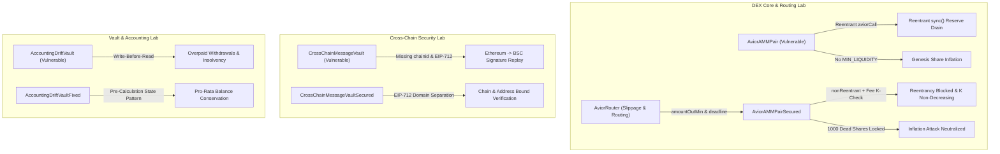

# DeFiSentinel — DEX & Cross-Chain Security Research Lab

[](https://github.com/srinathdoggala-tech/multichain-security-lab/actions/workflows/test.yml)
[](https://soliditylang.org/)
[](https://getfoundry.sh/)
[](./LICENSE)

An executable, evidence-backed smart contract security research laboratory designed for auditing **multi-chain decentralized exchanges (DEXs)**, automated market makers (AMMs), slippage routers, cross-chain bridges, and DeFi vaults.

Every vulnerability in this laboratory is reproduced in an isolated local test environment, validated through deterministic exploits, mitigated via hardened reference implementations, and protected by regression tests and stateful property-based invariant fuzzing.

> **Context & Attribution Notice:** This independent security research project was developed to explore attack surfaces relevant to multi-chain DEX architectures (such as AviorSwap). It builds upon and substantially extends educational primitives from [void-node/My-first-smart-contract-audit-lab](https://github.com/void-node/My-first-smart-contract-audit-lab). See [`NOTICE.md`](./NOTICE.md) for full provenance, copyright attribution, and an itemized breakdown of original vs. inherited contributions.

---

## 🏛️ Architecture & Threat Surface Matrix



---

## 🔬 Featured Security Modules

### 1. DEX Core AMM Security (`src/dex/`)
* **Vulnerabilities Demonstrated:**
  * **Flash-Swap Callback Reentrancy into `sync()`:** In [`AviorAMMPair.sol`](./src/dex/AviorAMMPair.sol), external flash swap callbacks invoke `IAviorCallee.aviorCall(...)` without a reentrancy guard. An attacker calls `pair.sync()` during the callback while output tokens are out, overwriting stored reserves with temporarily depleted balances. This neutralizes the post-swap invariant check and permits complete drain of pool reserves without repayment.
  * **Fee-Free Arbitrage & Zero-Fee Drain:** Omitting fee accounting from the invariant comparison allows capital extraction without fee accretion to LPs.
  * **Genesis Share Inflation:** Omitting a permanent burn of `MINIMUM_LIQUIDITY` allows a first depositor to inflate the share price via 1 wei minting plus direct token donation, causing subsequent victim deposits to round down to zero shares.
* **Secured Implementation:** [`AviorAMMPairSecured.sol`](./src/dex/AviorAMMPairSecured.sol) integrates OpenZeppelin `ReentrancyGuard`, an internal `_validateK` pure helper preventing EVM stack-too-deep errors, the canonical Uniswap v2 fee-adjusted invariant $(1000 \cdot b_0 - 3 \cdot in_0)(1000 \cdot b_1 - 3 \cdot in_1) \ge 1000^2 \cdot r_0 \cdot r_1$, accurate `amount0In`/`amount1In` event emission, and permanent dead-address liquidity locking (`MINIMUM_LIQUIDITY = 1000`).
* **Evidence & Invariants:**
  * Exploit test: [`test/dex/AviorAMMPairExploit.t.sol`](./test/dex/AviorAMMPairExploit.t.sol)
  * Regression test: [`test/regressions/AviorAMMPairRegression.t.sol`](./test/regressions/AviorAMMPairRegression.t.sol)
  * Stateful invariant test: [`test/invariants/AviorAMMPairInvariant.t.sol`](./test/invariants/AviorAMMPairInvariant.t.sol) (50,000 handler calls across 11 action types).
* **Research Documentation:** [`docs/AMM_SECURITY_REVIEW.md`](./docs/AMM_SECURITY_REVIEW.md) and [`reports/REPORT_DEX_01_AMM_REENTRANCY_RESERVE_DESYNC.md`](./reports/REPORT_DEX_01_AMM_REENTRANCY_RESERVE_DESYNC.md) (CVSS 9.8 Critical).

---

### 2. DEX Multi-Hop Router & Slippage Security (`src/dex/`)
* **Core Protection Module:** [`AviorRouter.sol`](./src/dex/AviorRouter.sol) provides educational exact-input swap execution with strict slippage protection, deadline enforcement, and safe multi-hop token routing.
* **Security Mechanics:**
  * **Slippage Bounds (`amountOutMin`):** Reverts with `InsufficientOutputAmount` if final received tokens fall below the user-specified threshold.
  * **Deadline Expiration (`block.timestamp <= deadline`):** Reverts with `ExpiredDeadline` to prevent miners/validators from withholding transactions in the mempool for adverse execution.
  * **Hop Isolation:** Chains intermediate hop outputs directly to the subsequent pool's balance via `_swapHop(...)`, eliminating EVM stack-too-deep overhead while ensuring the user's initial deposit strictly enters the first authorized pool.
  * **Path Validation:** Reverts on identical consecutive tokens, zero input amounts, zero recipient addresses, or unregistered pools.
* **Evidence & Adversarial Tests:**
  * Unit test: [`test/dex/AviorRouter.t.sol`](./test/dex/AviorRouter.t.sol) (single-hop, multi-hop `A -> B -> C`, quotes)
  * Regression suite: [`test/regressions/AviorRouterRegression.t.sol`](./test/regressions/AviorRouterRegression.t.sol) (10 tests: slippage violations, expired deadlines, invalid paths, allowance checks, property-based fuzzing, and 1 wei dust rounding edge cases).

---

### 3. Manipulation-Resistant TWAP Oracle Module (`src/dex/`)
* **Vulnerability Context:**
  * Protocols that rely on instantaneous AMM spot reserves (`reserve1 / reserve0`) for collateral valuation or liquidation pricing are inherently vulnerable to single-block flash loan manipulation (e.g., bZx, Harvest Finance).
* **Secured Architecture:** [`src/dex/AviorTWAPOracle.sol`](./src/dex/AviorTWAPOracle.sol)
  * Implements time-weighted average price (TWAP) calculation leveraging cumulative price accumulators in [`src/dex/AviorAMMPairSecured.sol`](./src/dex/AviorAMMPairSecured.sol) and fixed-point math [`src/dex/libraries/UQ112x112.sol`](./src/dex/libraries/UQ112x112.sol).
  * Enforces minimum observation period (`PERIOD = 1800s`), preventing intra-block updates.
  * Extrapolates current price accumulators forward across un-traded block intervals, securing downstream protocols against flash loan distortion.
* **Evidence:**
  * [`test/dex/AviorTWAPOracle.t.sol`](./test/dex/AviorTWAPOracle.t.sol) (6 tests: period elapsed enforcement, multi-period weighted convergence, flash-loan 10x spot distortion immunity, and invalid token protection).

---

### 4. Adversarial ERC-20 Token Integration Suite (`test/mocks/`, `test/dex/`)
* **Vulnerability Context:**
  * Real-world DeFi protocols regularly suffer severe exploits due to non-standard or adversarial token behaviors that break standard ERC-20 assumptions.
* **Adversarial Scenarios Tested & Proven:**
  1. **Fee-on-Transfer (FoT) Tokens ([`FeeOnTransferToken.sol`](./test/mocks/FeeOnTransferToken.sol)):** Proves that while [`AviorAMMPairSecured`](./src/dex/AviorAMMPairSecured.sol) safely calculates actual received token deltas for direct swaps, naive routers assuming full receipt suffer `InvalidK` reverts.
  2. **Rebasing / Elastic Supply Tokens ([`RebasingToken.sol`](./test/mocks/RebasingToken.sol)):** Demonstrates that positive supply expansions allow arbitrageurs to extract unearned LP yield via `pair.skim()`, while negative rebases force reserve drops on `pair.sync()`.
  3. **Missing Return Value Tokens ([`MissingReturnToken.sol`](./test/mocks/MissingReturnToken.sol)):** Validates that non-compliant tokens (like mainnet USDT) that omit boolean returns revert under naive interfaces but execute safely via OpenZeppelin `SafeERC20` in [`AviorRouter`](./src/dex/AviorRouter.sol).
  4. **Callback Reentrant Tokens ([`ReentrantHookToken.sol`](./test/mocks/ReentrantHookToken.sol)):** Proves that ERC-777/ERC-1363 transfer callback hooks attempting to reenter pool functions (`swap`, `mint`, `skim`, `sync`) are blocked by `ReentrancyGuard`.
* **Evidence:**
  * [`test/dex/AdversarialTokens.t.sol`](./test/dex/AdversarialTokens.t.sol) (6 passing tests).

---

### 5. Multi-Chain Bridge Message Verification (`src/crosschain/`)
* **Vulnerability Demonstrated:**
  * **Cross-Chain Signature Replay:** In [`src/CrossChainMessageVault.sol`](./src/CrossChainMessageVault.sol), validator signatures are computed over raw hashes `keccak256(abi.encodePacked(to, amount, nonce))` without binding `block.chainid` or `address(this)`. A signature issued for an authorized withdrawal on Ethereum (ChainID 1) is captured and replayed directly against the BSC (ChainID 56) vault instance, draining the entire secondary treasury.
* **Secured Implementation:** [`src/crosschain/CrossChainMessageVaultSecured.sol`](./src/crosschain/CrossChainMessageVaultSecured.sol) implements OpenZeppelin `EIP712` structured domain separation, explicit destination chain validation (`destinationChainId == block.chainid`), verifying contract binding, message ID idempotency, and monotonic per-user nonces.
* **Evidence & Threat Model:**
  * Exploit test: [`test/CrossChainMessageVault.t.sol`](./test/CrossChainMessageVault.t.sol)
  * Regression suite: [`test/regressions/CrossChainMessageVaultRegression.t.sol`](./test/regressions/CrossChainMessageVaultRegression.t.sol) (9 tests covering cross-chain replays, cross-contract replays, payload tampering, unauthorized signers, malformed signatures, and nonce atomicity).
  * Threat model: [`docs/CROSS_CHAIN_THREAT_MODEL.md`](./docs/CROSS_CHAIN_THREAT_MODEL.md) (STRIDE analysis, single-validator trust assumptions, and finality risks).
* **Audit Report:** [`reports/REPORT_CC_01_CROSS_CHAIN_MESSAGE_REPLAY.md`](./reports/REPORT_CC_01_CROSS_CHAIN_MESSAGE_REPLAY.md) (CVSS 10.0 Critical).

---

### 6. Share-Based Vault Accounting Drift (`src/`)
* **Vulnerability Demonstrated:**
  * **Write-Before-Read Share Ordering:** In [`src/AccountingDriftVault.sol`](./src/AccountingDriftVault.sol), `withdraw()` mutates `totalShares -= shares` before evaluating `payout = (shares * balance) / totalShares`. The prematurely shrunken denominator overpays the withdrawer at the expense of remaining depositors, and bricks full withdrawals with division by zero.
* **Secured Implementation:** [`src/AccountingDriftVaultFixed.sol`](./src/AccountingDriftVaultFixed.sol) computes payouts against pre-state snapshots prior to any state mutation.
* **Evidence:**
  * Unit & multi-depositor fuzz tests: [`test/AccountingDriftVault.t.sol`](./test/AccountingDriftVault.t.sol) (11 tests + 50,000 call invariant test).
  * Automated proof-of-vulnerability invariant: `InvariantTestVulnerable` demonstrates automated failure detection within 3 calls.
* **Audit Report:** [`reports/REPORT_VAULT_01_ACCOUNTING_DRIFT.md`](./reports/REPORT_VAULT_01_ACCOUNTING_DRIFT.md) (CVSS 8.1 High).

---

### 7. Inherited Vulnerability Modules Matrix

In addition to the primary DEX, router, TWAP oracle, adversarial token suite, and cross-chain research labs, the repository maintains educational exploit modules inherited from the upstream project:

| Lab ID | Category / Target | Flaw Description | Test Reference |
| :--- | :--- | :--- | :--- |
| **Lab 01** | Reentrancy (`Bank.sol`) | CEI pattern violation during ETH withdrawal | [`test/Exploit.t.sol`](./test/Exploit.t.sol) |
| **Lab 02** | Spot Price Oracle (`DeFiPool.sol`) | Low-liquidity spot price manipulation via flash loan | [`test/OracleAttack.t.sol`](./test/OracleAttack.t.sol) |
| **Lab 04** | Call Handling (`SimpleVault.sol`) | Unchecked raw `.call` return value in ETH distribution | [`test/SimpleVaultAttack.t.sol`](./test/SimpleVaultAttack.t.sol) |
| **Lab 05** | Flash Loan Rewards (`VulnerableVault.sol`) | Instantaneous balance query in reward calculation | [`test/FlashAttack.t.sol`](./test/FlashAttack.t.sol) |
| **Lab 07** | Bad Randomness (`TimeVault.sol`) | Predictable timestamp reliance | [`test/TimeVault.t.sol`](./test/TimeVault.t.sol) |
| **Lab 09** | Governance Hijacking (`Governance.sol`) | Flash-borrowed token voting power in single block | [`test/GovernanceTest.t.sol`](./test/GovernanceTest.t.sol) |
| **Lab 10** | Phishing Access Control (`StakingPool.sol`) | `tx.origin` authorization bypass | [`test/StakingPoolTest.t.sol`](./test/StakingPoolTest.t.sol) |
| **Lab 11** | Callback Reentrancy (`CreamMarket.sol`) | Reentrant callback during supply / borrow | [`test/CreamMarketTest.t.sol`](./test/CreamMarketTest.t.sol) |
| **Lab 12** | ERC-777 Hooks (`LendfMe.sol`) | `tokensReceived` hook reentrancy | [`test/LendfMeTest.t.sol`](./test/LendfMeTest.t.sol) |
| **Lab 13** | Vault Inflation (`InflatableVault.sol`) | Direct donation rounding attack | [`test/InflatableVault.t.sol`](./test/InflatableVault.t.sol) |
| **Lab 14** | TWAP Manipulation (`UniV3OracleLending.sol`)| Illiquid observation manipulation | [`test/UniV3OracleManipulationTest.t.sol`](./test/UniV3OracleManipulationTest.t.sol) |
| **Lab 15** | Read-Only Reentrancy (`ReadOnlyAttack.sol`) | Querying intermediate AMM pool state | [`test/ReadOnlyTest.t.sol`](./test/ReadOnlyTest.t.sol) |
| **Lab 16** | Cross-DEX Arbitrage (`ArbitrageVault.sol`) | Price disparity extraction across pools | [`test/ArbitrageTest.t.sol`](./test/ArbitrageTest.t.sol) |
| **Lab 17** | Signature Replay (`SignatureReplayVault.sol`) | Missing contract binding in signature hash | [`test/SignatureReplayVault.t.sol`](./test/SignatureReplayVault.t.sol) |
| **Lab 18** | Bridge Proof Forgery (`BridgeProofVault.sol`) | Merkle root leaf validation dynamics | [`test/BridgeProofVault.t.sol`](./test/BridgeProofVault.t.sol) |

---

## 📊 Verified Test Suite Results

Every test result documented below is factual and executed against local Foundry `v1.8.6` with Solc `0.8.28`:

```text
$ forge test -vvv

Ran 30 test suites: 77 tests passed, 0 failed, 0 skipped (77 total tests)
- AviorAMMPairExploitTest: 2 passed (Reentrant sync drain & Genesis share inflation)
- AviorAMMPairRegressionTest: 5 passed (Reentrancy mutex, fee enforcement, K-invariant fuzzing)
- AviorAMMPairInvariantTest: 1 passed (1,000 runs, 50,000 calls across K growth, reserve backing, dead address lock, zero-shares burn)
- AviorRouterTest: 6 passed (Single-hop quotes, fee deductions, multi-hop routing, optimal liquidity provisioning, liquidity burning)
- AviorRouterRegressionTest: 10 passed (Slippage violations, expired deadlines, invalid paths, property fuzzing, dust rounding)
- AviorTWAPOracleTest: 6 passed (Window enforcement, mathematical convergence, single-block flash loan manipulation immunity)
- AdversarialTokensTest: 6 passed (Fee-on-transfer, positive rebase skim theft, negative rebase reserve drop, SafeERC20 missing returns, reentrant callback mutex)
- CrossChainMessageVaultRegressionTest: 9 passed (Cross-chain replay, cross-contract replay, tampering, unauthorized signers, nonce atomicity)
- AccountingDriftVaultTest & InvariantTest: 12 passed (Pro-rata conservation, multi-depositor fuzzing, 50,000 calls)
- Inherited Labs: 20 passed (Baseline EVM vulnerability reproductions)
```

> **Automated Proof-of-Vulnerability Test:** The test suite includes an intentional failing invariant test (`test/AccountingDriftVault.t.sol:InvariantTestVulnerable`) demonstrating that Foundry's fuzzer detects post-state denominator drift in 3 calls. By default, `foundry.toml` excludes it so normal CI remains green. To execute this intentional demonstration:
> ```bash
> forge test -vvv --match-contract InvariantTestVulnerable --no-match-contract "^$"
> ```

---

## 🛠️ Reproduction & Testing Guide

### Prerequisites
- [Foundry](https://book.getfoundry.sh/getting-started/installation) (`forge`, `cast`, `anvil`)
- Git

### Installation
```bash
git clone https://github.com/srinathdoggala-tech/multichain-security-lab.git
cd multichain-security-lab
git submodule update --init --recursive
forge build
```

### Run All Passing Tests & Invariants
```bash
forge test -vvv
```

### Run Specific Security Modules
```bash
# 1. Run AMM Reentrancy Exploit & Invariant Suite
forge test -vvv --match-contract AviorAMMPairExploitTest
forge test -vvv --match-contract AviorAMMPairRegressionTest
forge test -vvv --match-contract AviorAMMPairInvariantTest

# 2. Run Router & Slippage Protection Tests
forge test -vvv --match-contract "AviorRouterTest|AviorRouterRegressionTest"

# 3. Run Cross-Chain Replay Regression Suite
forge test -vvv --match-contract CrossChainMessageVaultRegressionTest

# 4. Run Intentional Vulnerability Demonstration (Expected to Fail)
forge test -vvv --match-contract InvariantTestVulnerable --no-match-contract "^$"
```

### Check Formatting & Static Linting
```bash
forge fmt --check
forge build --sizes
```

---

## 📑 Security Audit Reports & Architecture Docs

Formal audit reports authored to professional standards are available in the [`reports/`](./reports/) and [`docs/`](./docs/) directories:

| Document / Report ID | Title | Scope | Status |
| :--- | :--- | :--- | :--- |
| [`AVIOR-DEX-001`](./reports/REPORT_DEX_01_AMM_REENTRANCY_RESERVE_DESYNC.md) | Flash Swap Callback Reentrancy into `sync()` Liquidity Drain | `AviorAMMPair.sol` | **Verified & Remediated** |
| [`AVIOR-CC-001`](./reports/REPORT_CC_01_CROSS_CHAIN_MESSAGE_REPLAY.md) | Cross-Chain Validator Signature Replay via Missing Domain Separation | `CrossChainMessageVault.sol` | **Verified & Remediated** |
| [`AVIOR-VAULT-001`](./reports/REPORT_VAULT_01_ACCOUNTING_DRIFT.md) | Write-Before-Read Share Accounting Drift Overpays Withdrawers | `AccountingDriftVault.sol` | **Verified & Remediated** |
| [`AMM_SECURITY_REVIEW`](./docs/AMM_SECURITY_REVIEW.md) | Comprehensive AMM Line-by-Line Re-Audit & Invariant Analysis | `src/dex/` | **Documented** |
| [`INVARIANTS`](./docs/INVARIANTS.md) | Formal Stateful Invariant Specification & Action Space | `test/invariants/` | **Documented** |
| [`CROSS_CHAIN_THREAT_MODEL`](./docs/CROSS_CHAIN_THREAT_MODEL.md) | Multi-Chain Bridge Threat Model & EIP-712 Verification Boundaries | `src/crosschain/` | **Documented** |
| [`SECOND_PHASE_REVIEW`](./docs/SECOND_PHASE_REVIEW.md) | Phase 2 Codebase Inspection & Remediation Audit | Repository-wide | **Documented** |
| [`REPORT_TEMPLATE`](./reports/REPORT_TEMPLATE.md) | Standardized Professional Security Reporting Framework | Reference | **Template** |

---

## 🛡️ Responsible Disclosure & Limitations

All contracts, exploits, and test scripts in this repository are developed strictly for educational, defensive security research, and smart contract auditing portfolio purposes.

- **Not Mainnet Deployed:** None of these contracts are deployed on live mainnet networks.
- **Single-Validator Trust Limitation:** The cross-chain bridge endpoint relies on an educational single-validator model. Production bridges require decentralized multi-signature sets (TSS, BLS) or zero-knowledge proof state verification.
- **No Production Warranty:** While remediations follow established security best practices, no warranty of bug-free execution is granted.