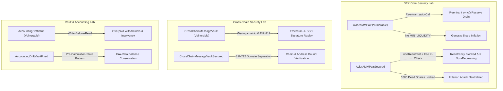

# DeFiSentinel — DEX & Cross-Chain Security Research Lab

[](https://github.com/void-node/My-first-smart-contract-audit-lab/actions/workflows/test.yml)
[](https://soliditylang.org/)
[](https://getfoundry.sh/)
[](https://opensource.org/licenses/MIT)

An executable, evidence-backed smart contract security research laboratory designed for auditing **multi-chain decentralized exchanges (DEXs)**, automated market makers (AMMs), cross-chain bridges, and DeFi vaults.

Every vulnerability in this laboratory is reproduced in an isolated local test environment, validated through deterministic exploits, mitigated via hardened reference implementations, and protected by regression tests and stateful property-based invariant fuzzing.

> **Provenance Notice:** This research lab evolved from [void-node/My-first-smart-contract-audit-lab](https://github.com/void-node/My-first-smart-contract-audit-lab). See [`NOTICE.md`](./NOTICE.md) for full provenance, copyright attribution, and a detailed separation between inherited baseline code and newly authored contributions.

---

## 🏛️ Architecture & Threat Surface Matrix



---

## 🔬 Featured Security Modules

### 1. DEX & AMM Security (`src/dex/`)
* **Vulnerabilities Demonstrated:**
  * **Callback Reentrancy via `sync()`:** In [`AviorAMMPair.sol`](./src/dex/AviorAMMPair.sol), flash swap callbacks invoke `IAviorCallee.aviorCall(...)` without a reentrancy guard. An attacker calls `pair.sync()` during the callback while output tokens are out, overwriting stored reserves with the temporarily depleted balances. This neutralizes the post-swap invariant check and permits theft of pool reserves without repayment.
  * **Fee-Free Arbitrage & Zero-Fee Drain:** Omitting fee accounting from the invariant comparison allows capital extraction without fee accretion to LPs.
  * **Genesis Share Inflation:** Omitting a permanent burn of `MINIMUM_LIQUIDITY` allows a first depositor to inflate the share price via 1 wei minting plus direct token donation, causing subsequent victim deposits to round down to zero shares.
* **Secured Implementation:** [`AviorAMMPairSecured.sol`](./src/dex/AviorAMMPairSecured.sol) integrates OpenZeppelin `ReentrancyGuard`, the canonical Uniswap v2 fee-adjusted invariant $(1000 \cdot b_0 - 3 \cdot in_0)(1000 \cdot b_1 - 3 \cdot in_1) \ge 1000^2 \cdot r_0 \cdot r_1$, and permanent dead-address liquidity locking (`MINIMUM_LIQUIDITY = 1000`).
* **Evidence & Invariants:**
  * Exploit test: [`test/dex/AviorAMMPairExploit.t.sol`](./test/dex/AviorAMMPairExploit.t.sol)
  * Regression test: [`test/regressions/AviorAMMPairRegression.t.sol`](./test/regressions/AviorAMMPairRegression.t.sol)
  * Stateful invariant test: [`test/invariants/AviorAMMPairInvariant.t.sol`](./test/invariants/AviorAMMPairInvariant.t.sol) (50,000 handler calls verifying $K$ preservation, reserve backing, and dead-address locking).
* **Audit Report:** [`reports/REPORT_DEX_01_AMM_REENTRANCY_RESERVE_DESYNC.md`](./reports/REPORT_DEX_01_AMM_REENTRANCY_RESERVE_DESYNC.md) (CVSS 9.8 Critical).

---

### 2. Multi-Chain Bridge Security (`src/crosschain/`)
* **Vulnerability Demonstrated:**
  * **Cross-Chain Signature Replay:** In [`src/CrossChainMessageVault.sol`](./src/CrossChainMessageVault.sol), validator signatures are computed over `keccak256(abi.encodePacked(to, amount, nonce))` without binding `block.chainid` or `address(this)`. A signature issued for an authorized withdrawal on Ethereum (ChainID 1) is captured and replayed directly against the BSC (ChainID 56) vault instance, draining the entire secondary treasury.
* **Secured Implementation:** [`src/crosschain/CrossChainMessageVaultSecured.sol`](./src/crosschain/CrossChainMessageVaultSecured.sol) implements OpenZeppelin `EIP712` structured domain separation, explicit destination chain validation (`destinationChainId == block.chainid`), verifying contract binding, message ID idempotency, and monotonic per-user nonces.
* **Evidence:**
  * Exploit test: [`test/CrossChainMessageVault.t.sol`](./test/CrossChainMessageVault.t.sol)
  * Regression test: [`test/regressions/CrossChainMessageVaultRegression.t.sol`](./test/regressions/CrossChainMessageVaultRegression.t.sol)
* **Audit Report:** [`reports/REPORT_CC_01_CROSS_CHAIN_MESSAGE_REPLAY.md`](./reports/REPORT_CC_01_CROSS_CHAIN_MESSAGE_REPLAY.md) (CVSS 10.0 Critical).

---

### 3. Share-Based Vault Accounting Drift (`src/`)
* **Vulnerability Demonstrated:**
  * **Write-Before-Read Share Ordering:** In [`src/AccountingDriftVault.sol`](./src/AccountingDriftVault.sol), `withdraw()` mutates `totalShares -= shares` before evaluating `payout = (shares * balance) / totalShares`. The prematurely shrunken denominator overpays the withdrawer at the expense of remaining depositors.
* **Secured Implementation:** [`src/AccountingDriftVaultFixed.sol`](./src/AccountingDriftVaultFixed.sol) computes payouts against pre-state snapshots prior to any state mutation.
* **Evidence:**
  * Exploit & invariant tests: [`test/AccountingDriftVault.t.sol`](./test/AccountingDriftVault.t.sol)
* **Audit Report:** [`reports/REPORT_VAULT_01_ACCOUNTING_DRIFT.md`](./reports/REPORT_VAULT_01_ACCOUNTING_DRIFT.md) (CVSS 8.1 High).

---

### 4. Inherited Vulnerability Modules Matrix

In addition to the primary DEX and cross-chain research labs, the repository retains the educational exploit modules inherited from the upstream project:

| Lab ID | Category / Target | Flaw Description | Test Reference |
| :--- | :--- | :--- | :--- |
| **Lab 01** | Reentrancy (`Bank.sol`) | CEI pattern violation during ETH withdrawal | [`test/Exploit.t.sol`](./test/Exploit.t.sol) |
| **Lab 02** | Spot Price Oracle (`DeFiPool.sol`) | Low-liquidity spot price manipulation via flash loan | [`test/OracleAttack.t.sol`](./test/OracleAttack.t.sol) |
| **Lab 04** | Call Handling (`SimpleVault.sol`) | Unchecked raw `.call` return value in ETH distribution | [`test/SimpleVaultAttack.t.sol`](./test/SimpleVaultAttack.t.sol) |
| **Lab 05** | Flash Loan Rewards (`VulnerableVault.sol`) | Instantaneous balance query in reward calculation | [`test/FlashAttack.t.sol`](./test/FlashAttack.t.sol) |
| **Lab 07** | Bad Randomness (`TimeVault.sol`) | Predictable timestamp reliance | [`test/TimeVault.t.sol`](./test/TimeVault.t.sol) |
| **Lab 09** | Governance Hijacking (`Governance.sol`) | Flash-borrowed token voting power in single block | [`test/GovernanceTest.t.sol`](./test/GovernanceTest.t.sol) |
| **Lab 10** | Phishing Access Control (`StakingPool.sol`) | `tx.origin` authorization bypass | [`test/StakingPoolTest.t.sol`](./test/StakingPoolTest.t.sol) |
| **Lab 11** | Callback Reentrancy (`CreamMarket.sol`) | Reentrant callback during supply / borrow | [`test/CreamMarketTest.t.sol`](./test/CreamMarketTest.t.sol) |
| **Lab 12** | ERC-777 Hooks (`LendfMe.sol`) | `tokensReceived` hook reentrancy | [`test/LendfMeTest.t.sol`](./test/LendfMeTest.t.sol) |
| **Lab 13** | Vault Inflation (`InflatableVault.sol`) | Direct donation rounding attack | [`test/InflatableVault.t.sol`](./test/InflatableVault.t.sol) |
| **Lab 14** | TWAP Manipulation (`UniV3OracleLending.sol`)| Illiquid observation manipulation | [`test/UniV3OracleManipulationTest.t.sol`](./test/UniV3OracleManipulationTest.t.sol) |
| **Lab 15** | Read-Only Reentrancy (`ReadOnlyAttack.sol`) | Querying intermediate AMM pool state | [`test/ReadOnlyTest.t.sol`](./test/ReadOnlyTest.t.sol) |
| **Lab 16** | Cross-DEX Arbitrage (`ArbitrageVault.sol`) | Price disparity extraction across pools | [`test/ArbitrageTest.t.sol`](./test/ArbitrageTest.t.sol) |
| **Lab 17** | Signature Replay (`SignatureReplayVault.sol`) | Missing contract binding in signature hash | [`test/SignatureReplayVault.t.sol`](./test/SignatureReplayVault.t.sol) |
| **Lab 18** | Bridge Proof Forgery (`BridgeProofVault.sol`) | Merkle root leaf validation dynamics | [`test/BridgeProofVault.t.sol`](./test/BridgeProofVault.t.sol) |

---

## 📊 Verified Test Suite Results

Every test result documented in this repository is factual, executed against local Foundry `v1.8.6` with Solc `0.8.28`:

```text
$ forge test -vvv --no-match-contract InvariantTestVulnerable

Ran 26 test suites: 42 tests passed, 0 failed, 0 skipped (42 total tests)
- AviorAMMPairExploitTest: 2 passed (Reentrant sync drain & Genesis share inflation)
- AviorAMMPairRegressionTest: 5 passed (Reentrancy mutex, fee enforcement, K-invariant fuzzing)
- AviorAMMPairInvariantTest: 1 passed (1,000 runs, 50,000 calls across K growth & reserve backing)
- CrossChainMessageVaultRegressionTest: 4 passed (Cross-chain replay blocked, nonce enforcement, chain fuzzing)
- AccountingDriftVaultTest & InvariantTest: 10 passed (Fixed pro-rata conservation, 50,000 calls)
- Inherited Labs: 20 passed (Baseline EVM vulnerability reproductions)
```

> **Note on `InvariantTestVulnerable`:** The test suite intentionally contains one failing invariant test (`test/AccountingDriftVault.t.sol:InvariantTestVulnerable`), which acts as an automated proof-of-vulnerability demonstrating that Foundry's invariant fuzzer discovers the accounting drift within 16 calls.

---

## 🛠️ Reproduction & Testing Guide

### Prerequisites
- [Foundry](https://book.getfoundry.sh/getting-started/installation) (`forge`, `cast`, `anvil`)
- Git

### Installation
```bash
git clone https://github.com/void-node/My-first-smart-contract-audit-lab.git
cd My-first-smart-contract-audit-lab
git submodule update --init --recursive
```

### Run All Passing Tests & Invariants
```bash
forge test -vvv --no-match-contract InvariantTestVulnerable
```

### Run Specific Security Modules
```bash
# 1. Run AMM Reentrancy Exploit
forge test -vvv --match-contract AviorAMMPairExploitTest

# 2. Run AMM Regression & Invariant Tests
forge test -vvv --match-contract AviorAMMPairRegressionTest
forge test -vvv --match-contract AviorAMMPairInvariantTest

# 3. Run Cross-Chain Replay Regression Test
forge test -vvv --match-contract CrossChainMessageVaultRegressionTest
```

### Run Static Analysis / Linter
```bash
forge build
```

---

## 📑 Security Audit Reports

Formal audit reports authored to professional standards are available in the [`reports/`](./reports/) directory:

| Report ID | Title | Target File | Severity |
| :--- | :--- | :--- | :--- |
| [`AVIOR-DEX-001`](./reports/REPORT_DEX_01_AMM_REENTRANCY_RESERVE_DESYNC.md) | Flash Swap Callback Reentrancy into `sync()` Liquidity Drain | `AviorAMMPair.sol` | **Critical (9.8)** |
| [`AVIOR-CC-001`](./reports/REPORT_CC_01_CROSS_CHAIN_MESSAGE_REPLAY.md) | Cross-Chain Validator Signature Replay via Missing Domain Separation | `CrossChainMessageVault.sol` | **Critical (10.0)** |
| [`AVIOR-VAULT-001`](./reports/REPORT_VAULT_01_ACCOUNTING_DRIFT.md) | Write-Before-Read Share Accounting Drift Overpays Withdrawers | `AccountingDriftVault.sol` | **High (8.1)** |
| [`REPORT_TEMPLATE`](./reports/REPORT_TEMPLATE.md) | Standardized Professional Security Reporting Framework | `*` | **Reference** |

---

## 🛡️ Disclaimer
All contracts, exploits, and test scripts in this repository are developed strictly for educational, defensive security research, and smart contract auditing portfolio purposes. None of these contracts are intended for deployment on live mainnet networks. No real private keys, mainnet RPC endpoints, or live assets were used.