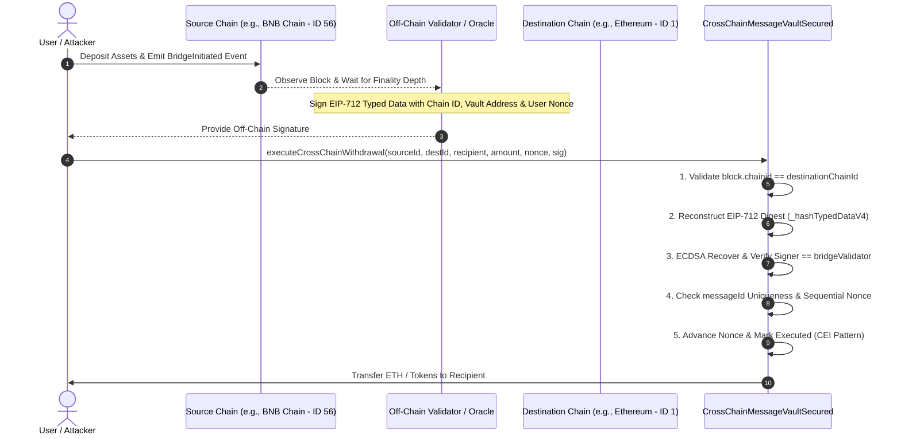

# DeFiSentinel — Cross-Chain Bridge Threat Model & Security Architecture

## 1. Executive Summary & Purpose

Cross-chain message passing and asset bridging represent one of the highest-risk attack surfaces in decentralized finance. Historical exploits (e.g., Ronin, Nomad, Poly Network, Wormhole) demonstrate that vulnerabilities rarely stem from ECDSA cryptography itself, but rather from:
1. **Ambiguous message identity** (lack of destination chain/contract binding allowing cross-chain replays).
2. **Centralized validator key compromise** (trusting single or low-threshold attestations).
3. **Execution layer desynchronization** (reorgs, block rollbacks, and optimistic finality assumptions).
4. **Permissive fallback handling and unauthenticated message routing**.

This threat model documents the security boundaries, cryptographic specifications, validator trust assumptions, and residual operational risks of the `CrossChainMessageVaultSecured` architecture implemented in the DeFiSentinel research lab.

---

## 2. System Architecture & Information Flow



---

## 3. Threat Model Analysis (STRIDE)

| Threat Category | Attack Vector | Vulnerable Implementation (`src/CrossChainMessageVault.sol`) | Secured Implementation (`src/crosschain/CrossChainMessageVaultSecured.sol`) | Residual Risk |
| :--- | :--- | :--- | :--- | :--- |
| **Spoofing** | Attacker executes withdrawal using a signature intended for another user or chain | Vulnerable: Message digest is a raw hash `keccak256(recipient, amount)` with zero domain separation. | Secured: ECDSA recovery requires signature matching `EIP-712` struct bound to `bridgeValidator`. | Validator private key compromise would allow signature spoofing. |
| **Tampering** | Altering amount, recipient, or destination contract in transit | Vulnerable: Recipient and amount can be passed without authenticating the target chain. | Secured: Any alteration of recipient, amount, nonce, source/destination chain, or contract address produces a mismatched digest and reverts. | None under valid SHA-256/Keccak-256 collision resistance assumptions. |
| **Repudiation / Replay** | Replaying a valid signature across multiple destination chains (e.g. Ethereum vs BSC) | **CRITICAL FLAW**: Signature produced on Chain A is valid and executable on Chain B, draining duplicate funds from all deployed vaults. | Secured: EIP-712 domain binds `block.chainid` and `address(this)`, combined with explicit check `destinationChainId == block.chainid`. | None on EVM-compliant chains adhering to EIP-1344. |
| **Same-Chain Replay** | Re-executing the same transaction on the same chain | Vulnerable: Vulnerable contract does not increment nonce or track unique message hashes. | Secured: Dual defense using monotonically increasing per-user nonces (`userNonces[recipient]`) and global message hash tracking (`executedMessageIds[messageId]`). | Out-of-order execution is intentionally rejected by sequential nonces. |
| **Information Disclosure** | Signature observation in public mempool | Front-running: Attacker copies signature from mempool and submits it themselves. | Mitigated: The withdrawal recipient is immutably bound inside the signed message. Even if front-run, the funds are delivered exclusively to `recipient`. | Gas griefing: Attacker front-running pays gas to execute recipient's legitimate withdrawal. |
| **Denial of Service** | Nonce desynchronization or griefing | If an unauthenticated call could advance a user's nonce, legitimate transactions would fail. | Secured: All checks (chain ID, signature recovery, signer authorization) occur **before** state mutations. Nonce is never advanced on reverted calls. | Network congestion on destination chain. |
| **Elevation of Privilege** | Reentrancy into withdrawal execution | Vulnerable: ETH transferred via `.call{value: amount}("")` before clearing state. | Secured: Follows strict Checks-Effects-Interactions (CEI) and enforces OpenZeppelin `nonReentrant` modifier. | Malicious recipient fallback can consume gas or revert, but cannot reenter. |

---

## 4. Cryptographic Domain Separation (EIP-712)

The secured bridge endpoint constructs a cryptographically rigid message hash adhering to **EIP-712**:

### TypeHash Definition
```solidity
bytes32 public constant WITHDRAWAL_TYPEHASH = keccak256(
    "WithdrawalMessage(uint256 sourceChainId,uint256 destinationChainId,address destinationContract,address recipient,uint256 amount,uint256 nonce)"
);
```

### Domain Separator Binding
The domain separator automatically embeds:
1. `name`: `"AviorCrossChainBridge"`
2. `version`: `"1"`
3. `chainId`: `block.chainid` (dynamically fetched from the executing EVM host via opcode `CHAINID` [EIP-1344])
4. `verifyingContract`: `address(this)` (the exact address of the deployed vault contract)

### Digest Construction
$$\text{Digest} = \text{keccak256}\left(\mathtt{0x1901} \parallel \text{DomainSeparator} \parallel \text{StructHash}\right)$$

This construction mathematically guarantees that:
- A signature generated for Ethereum (Chain ID 1) cannot be validated on BNB Smart Chain (Chain ID 56) or Arbitrum (Chain ID 42161).
- A signature generated for Vault A cannot be validated on Vault B, even on the exact same chain.
- An attacker cannot reuse signatures between different deployments or protocol versions.

---

## 5. Trust Assumptions & Operational Limitations

### 5.1 Single-Validator Trust Model (Educational Context)
> [!WARNING]
> The current reference contract `CrossChainMessageVaultSecured.sol` relies on an authorized **single validator key** (`bridgeValidator`).
> - **Trust Assumption:** The off-chain signer is trusted not to forge withdrawals or sign conflicting messages.
> - **Single Point of Failure (SPOF):** If the validator's private key is leaked, stolen, or compromised, the attacker can sign arbitrary withdrawal messages up to the total liquidity of the vault.
> - **Production Requirement:** A production bridge MUST utilize a decentralized validator set with an $M$-of-$N$ threshold multi-signature (e.g. BLS threshold signatures, ECDSA TSS, or light-client zero-knowledge proofs such as zk-SNARK state attestations).

### 5.2 Block Finality and Reorganization (Reorg) Risk
- **Source Chain Finality:** When bridging from Chain A to Chain B, the off-chain relayer must wait for **irreversible finality** (e.g., 2 epochs on Ethereum PoS, or 15+ block confirmations on PoW/Tendermint chains).
- **Attack Scenario:** If the relayer signs a withdrawal message after only 1 block confirmation on Chain A, and Chain A subsequently undergoes a 2-block reorg (reverting the initial user deposit), the funds are nonetheless permanently withdrawn on Chain B, resulting in an unbacked deficit.

### 5.3 EVM Chain ID Mutability & Hard Forks
- In rare circumstances of contentious hard forks (e.g. Ethereum vs Ethereum Classic, PoW fork), chain IDs may be duplicated or inherited unless replay protection is explicitly enforced by network client configurations.
- Using dynamic `block.chainid` ensures that upon any network split or hard fork, the executing contract reflects the genuine active network ID.

### 5.4 Local Foundry Test Simulation vs Live Multi-Chain Topology
- In Foundry local tests, multi-chain environments are simulated within a single VM instance using `vm.chainId(newChainId)`.
- While `vm.chainId` accurately resets the EVM `CHAINID` opcode (satisfying EIP-712 domain recalculation and destination verification), it does not simulate asynchronous network latencies, mempool propagation, RPC node divergence, or gas price volatility inherent in live cross-chain messaging.

---

## 6. Empirical Verification Matrix

All listed properties are backed by passing regression tests in `test/regressions/CrossChainMessageVaultRegression.t.sol`:

| Test Function | Property Verified | Status |
| :--- | :--- | :--- |
| `test_Regression_ValidWithdrawalSucceedsOnTargetChain` | Legitimate signature executes, releases ETH, updates nonces | **PASS** |
| `test_Regression_CrossChainReplayFailsOnDifferentChain` | EIP-712 domain + `destinationChainId` blocks cross-chain replay | **PASS** |
| `test_Regression_CrossContractReplayFailsOnSameChain` | Verifying contract binding blocks cross-contract replay | **PASS** |
| `test_Regression_SameChainDuplicateReplayFails` | Message hash idempotency prevents double spending | **PASS** |
| `test_Regression_TamperedPayloadReverts` | Tampering with recipient or amount invalidates ECDSA recovery | **PASS** |
| `test_Regression_UnauthorizedSignerReverts` | Signatures from non-validator keys revert | **PASS** |
| `test_Regression_MalformedSignatureReverts` | Signatures with invalid byte lengths revert | **PASS** |
| `test_Regression_FailedAttemptDoesNotAdvanceNonce` | Reverted executions preserve nonce state atomically | **PASS** |
| `testFuzz_DestinationChainMismatchAlwaysReverts` | Generalized property test proving all `target != actual` chain IDs revert | **PASS** |
